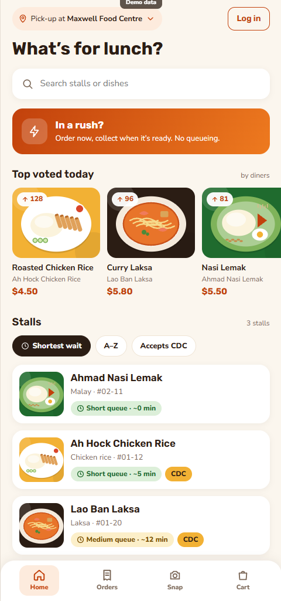
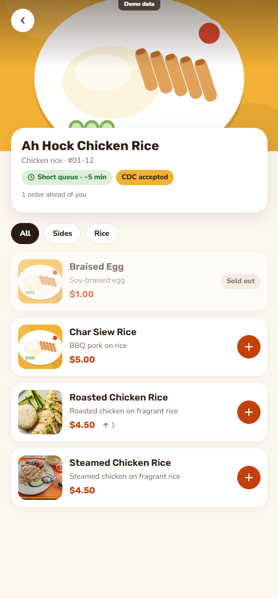
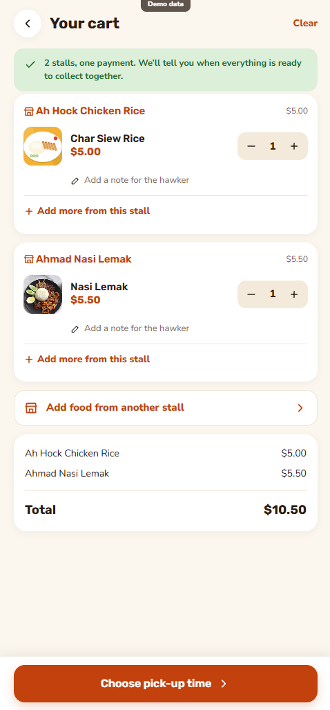
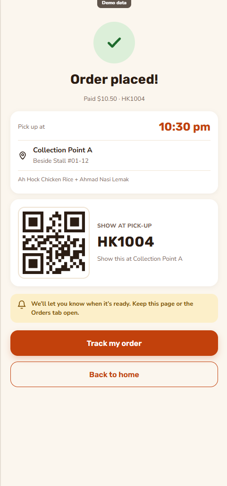

# Hawker eMenu

**Revitalising Hawker Culture in a Digital Economy** · FSDP, Team C33 · ByteHackz 2026

*Skip the queue, not the meal.*

A mobile-friendly web app for people with a short lunch break. Pre-order from one or more hawker stalls, pay once with NETS QR, and collect when the food is ready. Diners upload photos of dishes and upvote the best ones; the top-voted photo becomes the dish's picture on the eMenu.

## Try it live

**https://hawker-emenu-c33.vercel.app** (best on a phone, or a desktop browser at phone size)

| Role | Email | Password |
|---|---|---|
| Diner | demo@gmail.com | 12345678 |
| Hawker | hawker@gmail.com | 12345678 |

> The server runs on Render's free plan and sleeps when idle. The first load can take 30–60 seconds; after that it is fast.

<p>
  
  
  
  
</p>

## The problem

From our survey of 29 hawker centre diners:

- **79%** have 45 minutes or less for lunch
- **86%** have walked away from a long queue (52% do so often)
- **76%** have to queue again at every stall when buying from more than one
- **90%** would find live queue times useful; **86%** want to order from several stalls at once

## Features

**For diners**
- Browse stalls with **live queue times**, sort by shortest wait, filter by CDC vouchers
- **One cart across many stalls**, with a note for each dish
- Choose **ASAP or a pick-up time** and a collection point
- **Pay once with NETS QR** for the whole order
- **Track the order** stall by stall and get told when everything is ready; show the **pick-up QR** to collect
- Order history and receipts

**Co-created eMenu**
- Diners **upload real photos** of dishes
- **AI (Google Gemini) rejects photos that are not food**
- Diners **upvote** photos; the top-voted photo becomes the dish's picture on the menu

**For hawkers**
- **Live order board**: move each order from Preparing to Ready in one tap
- **Mark dishes sold out** instantly so diners cannot order them

## How it works

```
Phone browser ──► React app (Vercel) ──► Express API (Render) ──► Supabase (PostgreSQL + Storage)
                                              ├──► NETS QR (payment)
                                              └──► Google Gemini (food photo check)
```

The React app never talks to Supabase directly: every request goes **page → `api.js` → Express route → Supabase**. Only the server holds the keys. Prices are always read from the database on the server, never trusted from the phone.

## Tech stack

| Layer | Technology |
|---|---|
| Front end | React (Vite), React Router, qrcode.react |
| Back end | Node.js + Express |
| Database | Supabase (PostgreSQL) and Supabase Storage |
| Login | Own Express login (bcrypt passwords + JWT) |
| Payment | NETS QR (sandbox) |
| AI | Google Gemini image check |
| Hosting | Vercel (front end), Render (back end) |

## Team

| Name | Area |
|---|---|
| Zi Ying | Accounts and login, live order tracking, hawker dashboard and sold out, all front-end screens, deployment |
| Dana | Database (Supabase), photo upload, AI food check |
| Declan | NETS QR payment |
| Lennox | Cart, ordering, pick-up times, order history |
| Siyu | Hawker centres, stall browsing, search, eMenu, voting |

## Run it locally

You need **Node.js 18+** and **Git**. There is no local database: the app uses the team's Supabase project.

**1. Get the code**
```bash
git clone https://github.com/Lim-ZiYing/FSDP-ASG.git
cd FSDP-ASG
```

**2. Back end**
```bash
cd server
npm install
copy .env.example .env     # macOS/Linux: cp .env.example .env
npm run dev
```
Fill in `.env` with the values shared privately (never commit them). Check it works: http://localhost:3000/api/health

**3. Front end** (second terminal)
```bash
cd client
npm install
copy .env.example .env     # macOS/Linux: cp .env.example .env
npm run dev
```
Open http://localhost:5173. In Chrome press F12, then Ctrl+Shift+M to view it at phone size.

### Demo-data switch (`client/.env`)

We built every screen first on fake data, then connected each one to the real server as its route was finished. The switch is still there:

| `VITE_MOCK=` | What you get |
|---|---|
| `all` | Everything fake, no server needed. Any email logs in; emails starting with `hawker` log in as a hawker. |
| `unbuilt` (default) | Real server for every finished route; fake data only for the names still in `NOT_READY` in `client/src/api.js`. |
| `off` | Everything real. |

Restart `npm run dev` after changing it. To reset the fake data: browser console → `localStorage.clear()` → refresh.

## API

✓ = live on the real server. *Demo data* = the screen works but still uses sample data.

| Method | Endpoint | Auth | Story | Owner | Status |
|---|---|---|---|---|---|
| POST | `/api/auth/register` | – | FSDP-9 | Zi Ying | ✓ |
| POST | `/api/auth/login` | – | FSDP-35 | Zi Ying | ✓ |
| GET | `/api/auth/me` | ✓ | – | Zi Ying | ✓ |
| POST | `/api/auth/logout` | – | FSDP-10 | Zi Ying | ✓ |
| GET | `/api/hawker/orders` | hawker | FSDP-50 | Zi Ying | ✓ |
| PATCH | `/api/hawker/orders/:stallOrderId/status` | hawker | FSDP-51 | Zi Ying | ✓ |
| GET | `/api/hawker/menu` | hawker | FSDP-53 | Zi Ying | ✓ |
| PATCH | `/api/hawker/menu-items/:itemId/sold-out` | hawker | FSDP-53 | Zi Ying | ✓ |
| GET | `/api/track/:orderId` | ✓ | FSDP-48 | Zi Ying | ✓ |
| GET | `/api/stalls` | – | FSDP-11 | Siyu | ✓ |
| GET | `/api/stalls/:id` | – | FSDP-11 | Siyu | ✓ |
| GET | `/api/stalls/:id/menu` | – | FSDP-12 | Siyu | ✓ |
| GET | `/api/menu-items/:id` | – | FSDP-12 | Siyu | ✓ |
| POST / DELETE | `/api/votes/:photoId` | ✓ | FSDP-22 | Siyu | ✓ |
| GET | `/api/centres` | – | FSDP-68 | Siyu | Demo data |
| GET | `/api/centres/:id/top-dishes` | – | FSDP-22 | Siyu | Demo data |
| GET | `/api/stalls/search` | – | FSDP-41 | Siyu | Demo data |
| GET | `/api/centres/:id/collection-points` | – | FSDP-30 | Lennox | ✓ |
| GET | `/api/orders/pickup-slots` | ✓ | FSDP-29, 33 | Lennox | ✓ |
| POST | `/api/orders` | ✓ | FSDP-14, 65 | Lennox | ✓ |
| GET | `/api/orders/mine` | ✓ | FSDP-18 | Lennox | ✓ |
| GET | `/api/orders/:id` | ✓ | FSDP-43, 45 | Lennox | ✓ |
| POST | `/api/orders/:id/cancel` | ✓ | FSDP-44 | Lennox | ✓ |
| POST | `/api/payments/:orderId/nets-qr` | ✓ | FSDP-16 | Declan | ✓ |
| GET | `/api/payments/:orderId/status` | ✓ | FSDP-17 | Declan | ✓ |
| GET | `/api/photos/item/:itemId` | – | FSDP-34 | Dana | ✓ |
| GET | `/api/photos/item/:itemId/top` | – | FSDP-23 | Dana | ✓ |
| POST | `/api/photos/item/:itemId` | ✓ | FSDP-20, 21 | Dana | ✓ |
| DELETE | `/api/photos/:photoId` | ✓ | FSDP-46 | Dana | Demo data |

## Folder structure

```
FSDP-ASG/
├── database/          Supabase scripts, run in order                            Dana
│   ├── 01_schema.sql    all tables
│   ├── 02_security.sql  Row Level Security (menu data public, the rest private)
│   ├── 03_extras.sql    order numbers, indexes, vote rules, views, photo bucket
│   └── 04_seed.sql      sample data (WIPES all data, ask the group first)
├── docs/              team Git routine, AI provider spike, screenshots
├── server/src/
│   ├── index.js       starts the server and connects every route
│   ├── supabase.js    shared Supabase connection
│   ├── middleware/    requireAuth, requireRole                                  Zi Ying
│   ├── routes/        auth, hawker, tracking, centres, stalls, menuItems,
│   │                  votes, orders, payments, photos
│   └── services/      nets.js (Declan), aiFoodCheck.js and topPhotos.js (Dana)
└── client/
    ├── public/mock/   sample food pictures
    └── src/
        ├── App.jsx      every page and its route
        ├── api.js       every call to the server + the NOT_READY list
        ├── mocks.js     demo data; the comments are the data contracts
        ├── auth.jsx · cart.jsx · centre.jsx   shared app state
        ├── components/  reusable pieces (StallCard, MenuItemCard, QueuePill, PickupQr…)
        └── pages/       one file per screen, matching the Figma
```

## What's next

- Real-time updates (no refresh needed)
- Seat availability at the hawker centre
- Rewards for diners who upload and vote
- Dish suggestions based on time, budget and queue length

## Links

[Live app](https://hawker-emenu-c33.vercel.app) · [Figma file](https://www.figma.com/design/HMrIlQdr3NR0NfztB5lc5X)